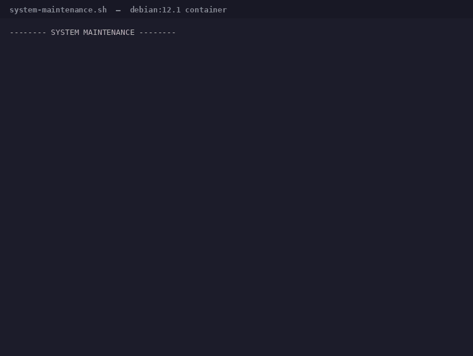
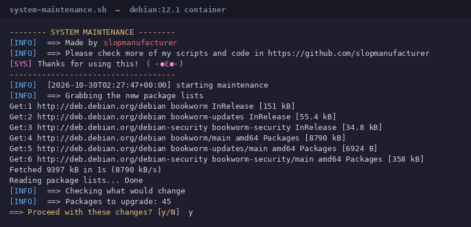
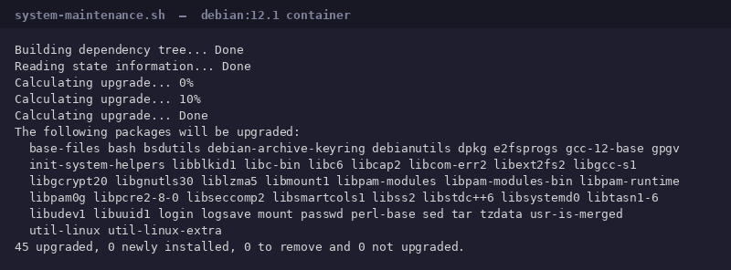

# Debian System Maintenance Script

[](LICENSE)

One command to update, clean and repair a Debian-based system. It shows you what
will change, **asks before touching anything**, and tells you if a reboot is needed.



## Quick start

```bash
git clone https://github.com/slopmanufacturer/debian-system-maintenance.git
cd debian-system-maintenance
sudo ./system-maintenance.sh
```

## What it does

| # | Step | Command |
|---|------|---------|
| 1 | Refresh package lists (3 attempts) | `apt-get update` |
| 2 | Show what would change | `apt-get -s full-upgrade` |
| 3 | **Ask for confirmation** | `Proceed? [y/N]` |
| 4 | Repair an interrupted dpkg state | `dpkg --configure -a` |
| 5 | Repair broken dependencies | `apt-get --fix-broken install -y` |
| 6 | Upgrade everything | `apt-get full-upgrade -y` |
| 7 | Remove unused packages **and their configs** | `apt-get autoremove --purge -y` |
| 8 | Clean the package cache | `apt-get autoclean` |
| 9 | Check for a pending reboot | `/var/run/reboot-required` |

## The confirmation prompt

Nothing is installed, removed or purged until you answer `y`. Before asking, the
script prints how many packages would be upgraded and names any that would be
removed or purged:



Answer anything but `y` and it exits with `nothing was changed`.

## Options

| Flag | Effect |
|------|--------|
| `-y`, `--yes` | Skip the confirmation prompt (cron, unattended runs) |
| `-h`, `--help` | Show usage |

Without `-y`, the script refuses to run if there is no terminal to confirm on,
so a cron job fails loudly instead of upgrading silently.

## Example

A run against a stock `debian:12.1` container, 45 packages behind:



## Requirements

- Debian, Ubuntu, Mint, Pop!_OS or any Debian derivative
- root (`sudo`)
- Bash 4.0+ (default everywhere)

## Safety notes

- **Your config files are kept.** Every `apt-get` call passes
  `-o Dpkg::Options::=--force-confdef -o Dpkg::Options::=--force-confold`, so dpkg
  never stops to ask which version of a config file to keep.
- **`autoremove` runs with `--purge`**, so config files of removed packages are
  deleted too. Drop `--purge` from that line if you would rather keep them.
- **`needrestart` is set to automatic** (`NEEDRESTART_MODE=a`), so the Debian 12+
  apt hook cannot block the upgrade.
- **Safe to re-run.** Every step is idempotent; running it twice in a row is a no-op.
- **Fails fast.** `set -euo pipefail` plus an `ERR` trap that reports the failing
  command and its exit status.

## License

MIT — see [LICENSE](LICENSE).

## Author

**slopmanufacturer** — [github.com/slopmanufacturer](https://github.com/slopmanufacturer)
